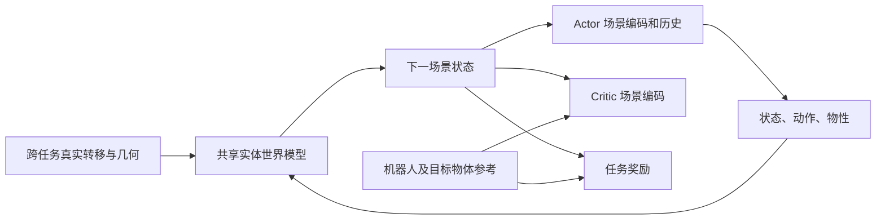

# 多实体共享世界模型

实现基于 `f714fc134d0f8e79ea908da5dc809a194932aaea`，开发分支为
`codex/shared-entity-world-model`。新增 `EntityTracking` 和 `EntitySitting` 两个任务，
原 `Tracking`、`SharedTracking`、`Sitting` 的入口与张量接口保留。
[单物体版本文档](shared-world-model.md) 描述的是保留的旧实现。

新世界模型统一预测 G1 和物体集合。任务参考、目标对象标记、奖励和终止条件放在任务层；
世界模型只接收状态、动作、几何和物性。两个新任务使用同一个网络结构，可共享动力学
checkpoint 和跨任务真实 Replay。新接触模式仍可能需要补充真实数据；接口可复用不代表
已经获得多物体泛化能力。目前没有完成坐下成功率、长期预测误差或训练效率基准。

## 当前范围

- 同一个无橡胶手几何的 29 DoF G1，50 Hz 控制，四个 5 ms 物理子步。
- 默认最多 `N=8` 个有限刚体槽，允许空槽、动态物体和固定障碍物；平面地面单独建模。
- `EntityTracking` 默认没有物体；`EntitySitting` 在槽 0 放置动态椅子和对应参考轨迹。
- 可以用配置增加多个箱子、固定墙体或从 NPZ 取得碰撞几何的刚体。这些对象参与真实
  物理、世界模型预测、Actor 场景观测和 Critic 场景计算。
- 现有统一 NPZ 仍只有一条物体轨迹。额外对象只有配置中的初始位姿，不作为目标对象。
  当前实现没有多目标 NPZ parser，也没有给 Actor 增加多个物体的未来任务目标。
- 一个并行环境批次使用同一套场景几何。目标椅子的动作按碰撞几何和缩放匹配；不同几何
  的真实数据可通过多次采集、Replay 导出与混合训练进入同一个世界模型。

这里 `N` 表示 padding 后的容量，实际有效物体数可以是 `0…N`。容量可通过
`--env.commands.motion.max-objects` 配置，当前校验范围为 1–32。增加容量会增加
状态存储和交互计算，不会为每个槽新增一套网络参数。

## 数据流和维度总览

默认历史 `H=10`、未来参考 `K=10`，令 `L=N+2`，其中两个额外实体为机器人和地面。

| 接口 | 一般形式 | 默认 `N=8` |
|---|---:|---:|
| Replay 完整状态 | `71 + 13N` | **175** |
| 世界模型输出增量 | `70 + 12N` | **166** |
| Replay context | `33 + 13N + 3L² + 4` | **441** |
| Actor 原始单帧观测 | `93 + 13N` | **197** |
| Actor 原始十帧历史 | `(93 + 13N) × H` | **1970** |
| Actor 编码后单帧 | `93 + 128` | **221** |
| Actor 编码后十帧历史 | `221 × H` | **2210** |
| Actor 机器人未来目标 | `73K → 32` | **730 → 32** |
| Actor 动作解码器输入 | `221H + 32` | **2242** |
| Critic 原始当前特征 | `184 + 38N + 3L² + 4` | **792** |
| Critic 未来机器人目标 | `73K` | **730** |
| Critic 未来物体目标 | `9NK` | **720** |
| Critic 原始总输入 | 当前特征 + 两类未来目标 | **2242** |
| Critic 最终价值 MLP 输入 | `184 + 128 + 73K` | **1042** |
| 动作 | 29 个关节目标偏移 | **29** |

Actor 的 2242 维解码输入与 Critic 的 2242 维原始输入恰好相同，含义完全不同。
也不要把原始 197 维观测与编码后的 221 维帧特征混用。旧方案的单物体 `93+6=99`
维接口只保留在旧 `Sitting` 任务；新任务采用集合编码。



## 状态与物性存储

张量状态为 `(p,R,v,w,q,qd, object_p,object_R,object_v,object_w)`。
物体字段具有独立的 `N` 轴；旋转矩阵用于计算，Replay 中转成 `wxyz` 四元数。
位置扣除并行环境原点，线速度和角速度为场景世界坐标下的 body 原点速度。

Context 分成四块：

| 块 | 形状 | 内容 |
|---|---|---|
| G1 物性 | `33` | 原地面摩擦 1、关节校准偏移 29、躯干 COM 偏移 3 |
| 物体物性与查表信息 | `N × 13` | 质量 1、COM 3、惯量 6、valid 1、dynamic 1、geometry ID 1 |
| 接触对摩擦 | `L × L × 3` | 滑动、扭转、滚动摩擦 |
| 地面平面 | `4` | 单位法线 `n` 三维和偏移 `d`，平面满足 `n·p=d` |

物体惯量关于 COM、在物体 body 坐标系表达，六个分量顺序为
`xx, yy, zz, xy, xz, yz`。物体 13 维 context 内索引为：`mass[0]`、`COM[1:4]`、
`inertia[4:10]`、`valid[10]`、`dynamic[11]`、`geometry_id[12]`。
摩擦矩阵实体顺序为 `robot, object_0…object_N-1, ground`；物理摩擦矩阵对称。

对象顺序可以置换，但一个 episode 内的槽必须保持对象身份对应。空槽四元数为单位
四元数；空槽不更新物体统计、不参与交互和损失。固定物体保留几何与关系，运动预测
增量为零。目标对象标记属于任务，未放进物理 context。

## 世界模型：输入到哪里

记 `H` 为当前 G1 的 yaw 旋转。机器人和物体使用不同输入编码器，所有物体共享同一个
编码器和输出头，不使用“第几个物体”的位置编码。

| 网络输入 | 内容 | 维度 |
|---|---|---:|
| 机器人 | 高度 1、去 yaw 姿态 6、机体系线/角速度 6、关节位置/速度 58、动作 29、原 context 33 | **133** |
| 每个物体运动 | `Hᵀ(p_i-p_g)` 3、`Rot6D(HᵀR_i)` 6、`Hᵀv_i` 3、`Hᵀω_i` 3 | **15** |
| 每个物体几何 | 共享点编码器输出 | **64** |
| 每个物体物性 | 质量 1、COM 3、惯量 6、dynamic 1 | **11** |
| 每个物体合计 | 运动 + 几何 + 物性 | **90** |
| 地面 | G1 到平面的有符号距离 1、G1 heading 中的平面法线 3 | **4** |

每类输入编码为 256 维 token。交互模块为四层、四个注意力头，使用全连接实体关系；
当前没有空间稀疏图或任意地形编码。

有限刚体之间的关系为接收方局部坐标中的相对位置 3、相对 Rot6D 6、相对线/角速度
6，加有效摩擦 3，共 **18** 维。刚体与地面的关系为距离 1、局部法线 3、局部线/角
速度 6、有效摩擦 3，共 **13** 维。两类关系分别编码为 **32** 维，既影响注意力权重，
也进入消息内容。无需依赖真实仿真器的接触力，在想象状态中可重新计算。

几何来自碰撞表面确定性面积采样，每个资产 `1024 × 6`：米制局部坐标 xyz 和单位
法线。网格缩放只施加一次。PointNet `6→64→128` 后做 max pooling，拼入三个米制
extents，再投影成 64 维。坐标不逐物体归一化到单位立方体，真实尺寸保留。
`EntityGeometryBank` 的格式版本为 **2**，只缓存原始点、法线、extents 和设备副本。
Actor、Critic、世界模型共享同一个几何编码器实例，只有 WM 动力学损失和优化器更新它。
Actor/Critic 读取几何特征时停止向该编码器反传梯度，各自的物体/场景编码器继续学习；
通过物体位姿、预测状态和动作的梯度路径保留。每次前向都按最新共享参数重算 embedding，
不会缓存跨 WM 更新的旧特征。编码器随 WM 更新后，Actor/Critic 会在后续更新中适应其表示。

连续输入按语义块归一化，只有有效物体和关系更新统计；ID 和 mask 不做数值特征。
物体位置/速度增量在当前 G1 heading 中表达，旋转增量在物体 body frame 中表达：
`p_next=p+H·dp`，`R_next=R·Exp(dtheta)`，速度类似。每步从预测状态重新计算关系和观测。
损失分别平均机器人与有效动态物体，再对两组平均，避免物体多的场景自动增大权重。

## Actor：原始观测和历史

原 G1 93 维观测、噪声与 29 维动作语义沿用。每个物体原始记录为
`相对位置3 + 相对Rot6D6 + valid1 + dynamic1 + target1 + geometry_id1 = 13`。
ID 查表得到 Actor 自己的几何特征，实际物体输入为 `位姿9 + 几何64 + dynamic1 + target1 = 75`。
共享物体编码器与 masked attention 聚合成128维场景特征，无物体时严格为零。
每帧 `93+128=221`，十帧2210，再拼机器人目标730编码后的32维，2242维送入29维动作解码器。
历史保存原始观测，前向时重新编码，避免模型更新后 latent 过期。

Actor 不看真实物体速度、质量、惯量、摩擦或物体未来目标；运动信息来自历史。
当前几何来自已知仿真资产，没有视觉感知前端。区分新的独立物体运动目标时，仍需扩展 Actor goal。
旋转有三个自由度，网络使用六维旋转编码。

## Critic：当前场景和物体参考轨迹

Critic 当前输入保留原G1 184维，每物体记录为
`运动15 + 质量/COM/惯量10 + dynamic1 + 当前位姿误差9 + target1 + valid1 + geometry_id1 = 38`，
再拼pair摩擦 `3L²` 和地面相对高度/法线4维，默认共792维。
未来机器人参考730维，物体未来参考为 `N×K×9=720` 维，总原始输入2242维。
每未来帧为相对位置3和Rot6D6，所有帧共用当前实际G1原点与heading，按物体优先排列；
未来索引在clip末尾截断。额外非目标物体的误差及未来参考置零，其实际状态仍参与计算。

每个目标物体的 `K×9` 未来轨迹通过 `90→128→64→32` 共享MLP编码。
物体当前信息加入自身几何特征组成100维，再拼未来轨迹32维，132维编码成128维token。
机器人、物体、地面token通过两层摩擦条件消息传递，聚合成128维场景特征。
最终 `184 + 128 + 730 = 1042` 维进入 `1042→256→128→1` 价值MLP。
物体未来参考实际进入Critic场景编码，未进入世界模型。

## 物理场景、奖励与域随机化

动态物体拥有free joint，固定物体使用mocap刚体。Reset从同一参考帧初始化G1和椅子位姿/速度；
额外对象回到配置初态、零速度。随后动态物体由重力和接触推进。部分reset不会改动其他环境。
原机器人tracking奖励、正则和终止条件沿用，只增加目标物体项：

```text
r_object = dt × weight × mean_targets(exp(-||p-p_ref||²/position_std²
                                         -||Log(R_refᵀR)||²/orientation_std²))
```

默认weight=1、position_std=0.1m、orientation_std=0.4rad、dt=0.02；新增项最大0.02。
当前仅椅子是目标，额外对象无目标奖励；空目标集合奖励为零。真实/想象轨迹使用同一函数。

| 参数 | 训练，每回合 | 评估 |
|---|---|---|
| 椅子质量、G1–椅子滑动摩擦 | 5–15kg、0.3–1.2 | 10kg、1.0 |
| 动态额外对象 | 默认同范围，可关闭随机化 | 配置mass、friction |
| 固定对象 | 配置mass、friction | 同训练 |

惯量随质量同比缩放。椅子惯量来自缩放原网格，盒子使用解析惯量；缺碰撞缓存或无效质量属性报错。
主碰撞体 `contype=2, conaffinity=2, priority=1` 与G1和其他物体交互；地面副本
`contype=0, conaffinity=1, priority=0` 仅接地，避免重复物体间接触。G1脚底球保留地面接触，
整脚mesh只接物体，自碰撞关闭。G1–物体采用物体摩擦；物体–物体各摩擦分量取max；
物体–地面取地面副本与地面的逐分量max，默认滑动1.0。原G1–地面随机化沿用，Replay记录有效值。

## 配置和命令

新任务默认 **128** 个训练环境、32 个 play 环境、256 步 Replay、WM batch 128、
Actor 想象 batch 128；8 步 WM 窗口与 32 步想象长度沿用。原任务的大 batch 默认值未改。
这组默认值降低多实体交互和几何编码的内存压力，仍需按 GPU、物体复杂度和训练测量调整。

准备目标椅子的碰撞缓存，然后启动新任务：

```bash
uv run --extra motion python tools/prepare_collisions.py \
  data/motions/sitting/sitting__acadian_rustic_wooden_dining_chair_distressed_white__000.npz

uv run train Mjlab-SuperMimic-EntitySitting-Unitree-G1 \
  --env.commands.motion.motion-dir data/motions/sitting/sitting__acadian_rustic_wooden_dining_chair_distressed_white__000.npz \
  --agent.experiment-name entity_sitting --gpu-ids '[0]' --log-root logs
```

`--env.commands.motion.object-motion-file` 可指定数据目录中的几何锚点。也可以使用
`Mjlab-SuperMimic-EntityTracking-Unitree-G1` 和 `data/motions/lafan1` 训练无目标物体
的机器人 tracking，共享同一种实体世界模型。

单场景多卡训练将上述参数改为 `--gpu-ids '[0,1]'`；每张卡独立运行环境和 Replay，
Actor、WM、Critic 每次更新同步梯度，几何编码器依旧只随 WM 更新。归一化使用各卡
有效样本的全局统计。环境数、WM batch、Actor batch 均为每卡数量，学习率不会自动放大。
模型和优化器每卡各一份，多卡不合并显存。只由 rank 0 保存模型和日志，Replay 导出
按 `.rank0000.pt` 等后缀区分。多椅子 80/20 实验使用独立的
[多卡入口](chair-generalization.md#多卡训练)，在各卡分配不同训练场景。

增加对象时保存以下内容为 `scene_objects.json`。`size` 是米制盒子**半尺寸**，
`pos` 是body原点；`quat` 默认单位wxyz：

```json
[
  {"name":"box", "size":[0.2,0.2,0.2], "pos":[1,0,0.2], "dynamic":true},
  {"name":"wall", "size":[0.1,0.5,0.5], "pos":[2,0,0.5], "dynamic":false, "friction":0.6}
]
```

在 train 命令追加：

```bash
--env.commands.motion.extra-objects-file scene_objects.json \
--env.commands.motion.max-objects 8
```

文件内容是 `ObjectCfg` 记录列表。可选 `asset_file` 指向包含几何的标准 NPZ，路径相对
JSON 所在目录解析；此时使用 NPZ 的几何，仍使用记录里的初始位姿，不将该 NPZ 轨迹
变成新的任务目标。Python 中也可用
`make_env_cfg(extra_objects=(ObjectCfg(...), ObjectCfg(...)))` 配置。
对已存在的 tuple 元素，原生 Tyro 的位置参数写法为
`--env.commands.motion.extra-objects.0.pos '(2,1,0.2)'`，不能拆成三个裸参数。
默认空 tuple 使用 JSON 参数创建额外对象；CLI 配置重建后，场景工厂绑定到新 command。

原生参数名已用 `train Mjlab-SuperMimic-EntitySitting-Unitree-G1 --help` 检查。
Stock play没有嵌套env参数，多物体播放可通过环境变量还原场景和容量：

```bash
SUPERMIMIC_MOTION_DIR=/path/to/target_motion.npz \
SUPERMIMIC_EXTRA_OBJECTS_FILE=/path/to/scene_objects.json \
SUPERMIMIC_MAX_OBJECTS=8 \
uv run play Mjlab-SuperMimic-EntitySitting-Unitree-G1 --checkpoint-file /path/to/model_N.pt
```

量化评估从完整checkpoint恢复容量和额外对象配置：

```bash
uv run python -m supermimic.scripts.evaluate \
  --task Mjlab-SuperMimic-EntitySitting-Unitree-G1 \
  --motion-dir /path/to/target_motion.npz --checkpoint-file /path/to/model_N.pt \
  --record /path/to/evaluation.npz --device cuda:0
```

## Checkpoint、跨任务复用与 Replay

保存完整任务 `model_N.pt` 和独立物理 `world_models/model_N.pt`；开启
`--agent.export-world-model-replay True` 时另存 `replays/model_N.pt`，辅助目录不参与resume搜索。
完整任务使用**schema5**，保存三类网络/优化器/归一化器、geometry bank、对象配置和几何身份。
共享编码器只属于 WM 优化器，Actor/Critic 优化器排除这组参数。完整存档中的三条几何
编码器参数路径必须数值一致；恢复后重新绑定到同一个模块。单独推理通过 Actor 保存的
编码器参数即可运行。旧 schema4 完整任务存档不直接恢复，但其独立 entity WM 存档仍可
加载，用来初始化共享编码器和动力学网络。
几何key包含碰撞几何与尺度。恢复任务要求场景与schema匹配；推理不创建世界模型或Replay。

独立世界模型只恢复物理权重和归一化器。共享权重支持跨 `max_objects` 容量加载，仍验证机器人、
周期、动作/状态语义和网络配置。旧f714单物体模型不隐式转换。目标任务train可追加：

```bash
--agent.world-model-file /path/to/source/world_models/model_N.pt \
--agent.world-model-replays "('/path/to/source/replays/model_N.pt',)" \
--agent.world-model-replay-fraction 0.5
```

物理checkpoint可单独加载；Replay路径是Python tuple字面量。完整续训使用原生resume选项。
**Replay导入目前要求容量完全一致**，不提供跨容量padding/conversion。档案含真实
`s,s1,a,xi,done` 和geometry bank，不含旧任务目标。导入校验episode内实体身份并重映射几何ID；
窗口保留终止transition，但不跨reset。旧数据只参与动力学拟合，Actor起点来自当前任务Replay。
完整resume后在线Replay重新填充，旧档案须用上述参数显式加载。

## 验证与边界

本分支全套回归为 **170 项通过**。运行完整套件可使用
`PYTEST_DISABLE_PLUGIN_AUTOLOAD=1 uv run pytest`。

新增测试覆盖集合置换、空槽/静态物体、尺度与摩擦条件、交互与几何梯度、Critic未来目标、
checkpoint及Replay迁移。CUDA集成使用两个世界中的椅子、动态箱子和固定墙，检查真实接触、
有效摩擦、无重复地面副本、落地支撑、部分reset，并执行三类网络更新和跨任务混合Replay。

```bash
PYTEST_DISABLE_PLUGIN_AUTOLOAD=1 uv run pytest tests/test_entity_env.py \
  tests/test_entity_world_model.py tests/test_entity_policy.py tests/test_entity_runner.py
```

原生CLI也在两个环境、目标椅子与箱子场景中，完成默认256宽、4层世界模型的一次更新和导出，
并完成评估/轨迹记录；产物在
`logs/entity_architecture_smoke/f714_entities/2026-10-26_01-08-19/`（不入Git）。
该未收敛策略在51帧后终止，不能当作坐下成功结果。
软件检查未证明长期预测、未知几何或多物体接触链泛化。复杂椅子还需几何/穿透审计。
当前不支持非平面地形、关节物体、可变机器人、感知估计或episode中动态增删实体。
