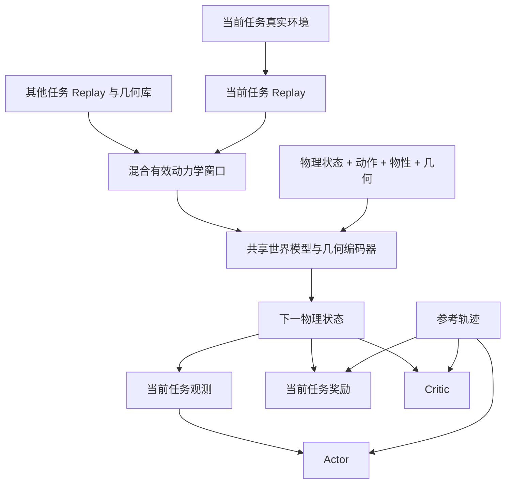

# G1 共享世界模型与坐椅子任务

实现范围是同一个 29 关节 G1、50 Hz 控制、平地，以及最多一个可运动刚体。
Tracking 与 Sitting 可以复用动力学参数和几何编码器；参考轨迹、奖励、Actor 和
Critic 属于任务层。新增任务加载已有物理模型后，可以混合旧任务数据继续学习。

当前工程验证包含真实接触、学习更新和跨任务权重加载；尚无完整坐椅子训练结果、
成功率或跨椅型泛化基准。一次迭代通过不表示策略已经学会坐下。

## 三个任务与维度

任务 ID 的公共前缀是 `Mjlab-SuperMimic-`，公共后缀是 `-Unitree-G1`。

| 接口 | `Tracking`：原基线 | `SharedTracking`：无物体 | `Sitting`：动态椅子 |
|---|---:|---:|---:|
| 完整状态存储 | 71 | 84 | 84 |
| Context 存储 | 33 | 47 | 47 |
| Actor 单帧观测 | 93 | 93 | 99 |
| Actor 十帧历史 | 930 | 930 | 990 |
| Actor 未来机器人目标 | 730 | 730 | 730 |
| 目标编码 latent | 32 | 32 | 32 |
| Actor 解码器输入 | 962 | 962 | 1022 |
| 动作 | 29 | 29 | 29 |
| 世界模型输入 | 133 | 228 | 228 |
| 世界模型预测增量 | 70 | 82 | 82 |
| Critic 当前特征 | 184 | 285 | 285 |
| Critic 未来参考 | 730 | 790 | 790 |
| Critic 总输入 | 914 | 1075 | 1075 |

上表采用默认十帧历史与十帧目标。原 `Tracking` 保留原接口；两个新任务使用同一
`SharedDynamics` 和 `SharedWorldModel`。旧的 133→70 世界模型不能隐式转换为
新模型，需先训练一次共享接口。之后两个共享任务使用同一份物理 checkpoint。



## 物理状态、Context 和输入处理

纯张量状态为 `(p, R, v, w, q, qd, object_p, object_R, object_v, object_w)`。
两种位置均为扣除并行环境偏置后的世界坐标；速度均为世界坐标下的 body 原点速度。
张量计算使用旋转矩阵；Replay 使用 `wxyz` 四元数，得到机器人 71 + 物体 13 = 84。

Context 的切片采用 Python 的左闭右开索引：

| 切片 | 内容 | 维度 |
|---|---|---:|
| `0:33` | 原 G1 地面摩擦、29 个关节校准偏移、躯干 COM 偏移 | 33 |
| `33:34` | 物体质量，kg | 1 |
| `34:37` | 物体 COM，body 坐标，m | 3 |
| `37:43` | 关于 COM、在 body 坐标表达的惯量：xx, yy, zz, xy, xz, yz | 6 |
| `43:44` | G1–物体滑动摩擦 | 1 |
| `44:45` | 物体–地面滑动摩擦 | 1 |
| `45:46` | 物体存在标记 | 1 |
| `46:47` | 当前几何库的 ID，仅用于查表 | 1 |

其中真正的物性是前 **45 维**。原 33 维沿用已有缩放，质量使用 `(m-10)/5`，
其余物体物性保持物理单位，再经过世界模型运行统计归一化。标记和 ID 不归一化；
**ID 不进入 MLP**，也不把任务名称或 reference 输入世界模型。

令 `H` 表示 G1 当前 yaw 旋转。世界模型实际输入为：

| 输入块 | 维度 | 表达 |
|---|---:|---|
| 机器人特征 | 71 | 高度 1、去 yaw 姿态 6、机体线/角速度 6、关节位置/速度 58 |
| 物体特征 | 15 | `Hᵀ(p_o-p_g)` 3、`Rot6D(HᵀR_o)` 6、`Hᵀv_o` 3、`Hᵀω_o` 3 |
| 实际执行动作 | 29 | 与真实采集一致，包含探索噪声和执行前裁剪 |
| 物性 | 45 | 上表前 45 维 |
| 几何 | 67 | 64 维形状编码 + 3 维真实 extents |
| 存在标记 | 1 | 保留 0/1 |
| **合计** | **228** | |

几何流程：离线凸分解表面确定性采样 1024 点 → 应用一次物体缩放 → 保持 body
原点，用最大包围盒边长作等比例归一化 → PointNet `3→64→128`、最大池化、
`128→64` → 拼接三个米制 extents。编码器随动力学损失联合训练。
`GeometryBank` 缓存采样点和设备副本，不缓存训练过程中会过期的 latent。

共享 MLP 使用 `228→2048→2048→2048→82`，隐藏层为 SiLU 与 LayerNorm。
输出反归一化后积分回 84 维状态：机器人仍为原 70 维增量；物体增加位移、旋转、
线速度和角速度各 3 维。物体位移及速度增量在当前 G1 heading 下表达，旋转增量
在当前物体 body frame 下表达：`p_next=p+H*dp`，`R_next=R*Exp(dtheta)`。
下一步根据预测状态重新计算 heading。

SharedTracking 的物体标记为零，四元数占位为单位四元数。对象输入在归一化后
置零，对象统计仅由有效对象样本更新；对象损失和积分增量也屏蔽。整个模型仍联合
预测机器人与物体，物体可以影响机器人下一状态。

## Actor、Critic 与奖励

原 Actor 的 93 维依次为相对关节角 29、关节速度 29、机体角速度 3、机体重力
方向 3、上一动作 29。Sitting 新增 `Hᵀ(p_o-p_g)` 和 `Log(HᵀR_o)` 共 6 维。
这是三维相对位移，不是单个距离。新增物体观测目前不加噪声；原机器人噪声沿用。
Actor 的运行归一化与目标归一化独立，目标编码器输出 32 维，再拼历史送入解码器。

Critic 保留原 184 维当前特征，并加入物体当前特征 15、当前位姿误差 6、新增
物性 12、几何 67、存在标记 1，合计 **285**。几何由当前世界模型编码并 detach，
Critic 更新不修改几何编码器。

Critic 额外接收未来十帧机器人目标 **730** 维和物体目标 **60** 维。每帧物体目标
包括参考位置 3、旋转向量 3；十帧全部使用当前实际 G1 的同一个 heading 坐标系。
因此 Critic 共 **1075** 维，MLP 为 `1075→256→128→1`。
SharedTracking 中物体特征和物体未来目标为零。

Actor 目前不接收物体未来目标，也不接收几何或特权物性。因此，不能用这套 Actor
接口声称支持任意不同的移动物体目标；后续这类任务需增加对应目标条件。
三维旋转向量在 π 附近存在分支，不是全局连续姿态表示。

机器人 tracking 奖励、正则权重和终止条件沿用。Sitting 只增加：

```text
object_reward = dt * weight * exp(
    -||p_o - p_ref||² / position_std²
    -||Log(R_refᵀ R_o)||² / orientation_std²
)
```

默认 `dt=0.02`、`weight=1`、`position_std=0.1 m`、`orientation_std=0.4 rad`。
参考与实际物体姿态在同一场景坐标中比较，物体不随机器人重新锚定。该项最大为
0.02，Sitting 总奖励最大为每步 0.12。真实与想象轨迹使用同一个奖励函数。

## 椅子场景与随机化

Reset 从同一参考帧初始化机器人和椅子的位姿、速度。此后椅子是自由刚体，由重力
和接触推进；不会每帧写回参考位置。G1 已移除橡胶手视觉及碰撞几何，保留腕关节
和原质量惯量；交互任务启用整脚物体碰撞，原脚底小球继续负责地面接触。

| 参数 | 训练，每回合采样 | 评估 |
|---|---|---|
| 椅子质量 | 5–15 kg | 10 kg |
| G1–椅子滑动摩擦 | 0.3–1.2 | 1.0 |
| 椅子–地面滑动摩擦 | 固定 1.0 | 1.0 |

改变质量时同步缩放惯量。G1 接触和地面接触使用不同碰撞过滤副本，G1–椅子的
接触优先级确保该摩擦值被实际采用，不改变原 G1–地面的摩擦逻辑。
惯量由缩放后的原始网格按均匀密度求得；只进行有限小孔修补。无法形成有效闭合
正体积模型时明确报错，不悄悄替换为盒子惯量。

默认使用目录中第一段动作作为几何锚点，或通过
`--env.commands.motion.object-motion-file /path/to/clip.npz` 选择锚点。
加载器只选择 mesh、碰撞缓存键和 scale 全部匹配的动作，并报告排除数量。
一批 MuJoCo 环境不会把不同椅型当成同一个物体。当前库有 189 种几何，先前碰撞
审计生成了其中 24 种缓存，不能据此声称全部椅型已验收。缺缓存时先运行：

```bash
uv run --extra motion python tools/prepare_collisions.py /path/to/clip.npz
uv run python tools/check_collisions.py /path/to/clip.npz --render
```

数据与缓存不入 Git；隔离开发工作树可通过 `data` 符号链接共享已有数据。
运行时只读取动作和碰撞缓存；复制代码到新位置时须另外准备或链接数据。

## 运行与复用

以下命令已用原生 `train` 完成一次真实迭代，使用完整默认网络宽度、两个环境和
小 batch。它验证训练、保存和 Replay 导出通路，不是收敛训练配置：

```bash
uv run train Mjlab-SuperMimic-Sitting-Unitree-G1 \
  --env.commands.motion.motion-dir data/motions/sitting/sitting__acadian_rustic_wooden_dining_chair_distressed_white__000.npz \
  --env.scene.num-envs 2 --agent.max-iterations 1 \
  --agent.buffer-steps 8 --agent.utd 1 --agent.horizon 2 \
  --agent.wm-window 2 --agent.wm-batches 1 --agent.wm-batch 2 --agent.pi-batch 2 \
  --agent.warmup-steps 0 --agent.wm-only-iters 0 \
  --agent.critic-epochs 1 --agent.critic-minibatches 1 \
  --agent.no-compile True --agent.amp none \
  --agent.export-world-model-replay True \
  --agent.experiment-name codex_sitting_smoke --gpu-ids '[0]' --log-root logs
```

布尔配置要显式写 `True`。正常训练应根据显存、数据量和验证结果调整环境数、batch、
训练迭代及 warmup，不把上面的单次更新当成有效坐下策略。

每次共享任务保存 checkpoint，目录结构是：

```text
logs/<experiment>/<run>/
├── model_N.pt                 # 完整任务：Actor、Critic、WM、优化器与任务元数据
├── world_models/model_N.pt    # 共享物理：WM、几何编码器、归一化器、动力学 schema
└── replays/model_N.pt         # 可选：真实转移与几何库
```

`world_models/` 和 `replays/` 不参与原生完整 checkpoint 的 resume 搜索。
只加载 Actor 的推理不创建世界模型或 Replay。两个新任务的完整 checkpoint 使用
任务 schema 3；原 Tracking 使用 schema 2，不能按相同输入宽度推断权重兼容。

复用共享物理时，在目标任务的 `train` 命令添加这些参数：

```bash
--agent.world-model-file /path/to/source_run/world_models/model_N.pt \
--agent.world-model-replays "('/path/to/source_run/replays/model_N.pt',)" \
--agent.world-model-replay-fraction 0.5
```

例如目标任务可以是 `Mjlab-SuperMimic-SharedTracking-Unitree-G1`，或换一个锚点
的 Sitting。它创建目标任务自己的 Actor/Critic，加载共享物理权重和归一化器。
`world_model_replays` 是路径元组；原生 CLI 要求 Python 元组字面量，单个路径也必须
保留括号与末尾逗号。多个来源写作 `"('first.pt', 'second.pt')"`，不能直接传裸路径。
`world_model_file` 可以单独用。
完整任务续训仍使用 `--agent.resume True`，与只迁移物理模型是不同的入口。

下面的跨任务通路也已通过原生 CLI 验证。把 `SITTING_RUN` 换成上一条命令输出的
运行目录；它仍使用同一段 sitting 机器人参考，但 SharedTracking 环境中没有椅子。
此处检验权重迁移及旧物体数据混合，不是行走性能实验：

```bash
SITTING_RUN=logs/codex_sitting_smoke/YOUR_RUN_DIRECTORY
uv run train Mjlab-SuperMimic-SharedTracking-Unitree-G1 \
  --env.commands.motion.motion-dir data/motions/sitting/sitting__acadian_rustic_wooden_dining_chair_distressed_white__000.npz \
  --env.scene.num-envs 2 --agent.max-iterations 1 \
  --agent.buffer-steps 8 --agent.utd 1 --agent.horizon 2 \
  --agent.wm-window 2 --agent.wm-batches 1 --agent.wm-batch 2 --agent.pi-batch 2 \
  --agent.warmup-steps 0 --agent.wm-only-iters 0 \
  --agent.critic-epochs 1 --agent.critic-minibatches 1 \
  --agent.no-compile True --agent.amp none \
  --agent.world-model-file "$SITTING_RUN/world_models/model_1.pt" \
  --agent.world-model-replays "('$SITTING_RUN/replays/model_1.pt',)" \
  --agent.world-model-replay-fraction 0.5 \
  --agent.experiment-name codex_shared_transfer_smoke --gpu-ids '[0]' --log-root logs
```

导出只包含真实 `s,s1,a,xi,done` 和几何库，不包含任务 reference。读取档案时校验
动力学 schema，并把每份档案的几何 ID 映射到本次运行的几何库；两个来源的 ID 1
不会被误认为同一种椅子。窗口不跨档案或环境，终止 transition 本身有效，后续 reset
步骤的损失被屏蔽。默认一半 WM 窗口来自旧档案；有效样本参与共享归一化统计。
Actor 的想象起点始终从当前任务 Replay 取，旧任务帧索引不会进入当前 reference。

## 验证边界

一次迭代 checkpoint 还经过了原生 evaluator 与轨迹记录检查。单段 acadian 动作的
归一化回报为 **0.14290756，1/1 段跟踪失败**；这是未收敛策略的实际结果，不是成功坐下。
记录含 51 帧实际机器人/椅子状态和 249 帧参考，所有记录值有限。复现命令：

```bash
uv run python -m supermimic.scripts.evaluate \
  --task Mjlab-SuperMimic-Sitting-Unitree-G1 \
  --motion-dir data/motions/sitting/sitting__acadian_rustic_wooden_dining_chair_distressed_white__000.npz \
  --checkpoint-file "$SITTING_RUN/model_1.pt" \
  --record "$SITTING_RUN/evaluation.npz" --device cuda:0
```

本地实测产物保留在开发 worktree 的
`logs/codex_sitting_smoke/2026-10-25_22-30-48/`，包含配置、CSV、完整模型、独立
世界模型、真实 Replay、`model_1_eval.json` 与 `evaluation.npz`。
跨任务继续训练产物在 `logs/codex_shared_transfer_smoke/`。这些数据不入 Git。

本次全套回归为 113 项通过、6 条 warning，覆盖坐标/积分一致性、缺席物体统计和损失屏蔽、
几何与动作梯度、参考条件、真实物理 reset/随机化、共享任务学习、checkpoint
加载及旧数据混合。原生 CLI 另完成了完整宽度网络的一次 Sitting 更新与产物导出，
以及加载该物理权重、混合该 Replay 的一次 SharedTracking 更新；两次均关闭编译。
另用隐藏宽度 32 的小模型验证了真实 CUDA TorchInductor 编译后的前向结果和动作梯度
与 eager 一致（`atol=2e-5, rtol=2e-4`）。这不是全尺寸编译性能测试。
上述验证没有测量长期预测误差、坐下成功率、训练效率或未知椅型泛化。

```bash
PYTEST_DISABLE_PLUGIN_AUTOLOAD=1 uv run pytest
```

禁用自动插件加载可避免宿主系统的 ROS pytest 插件干扰项目虚拟环境。
缺少 CUDA、资产或对应缓存的测试可能跳过；应同时检查实际报告中的通过与跳过数。
