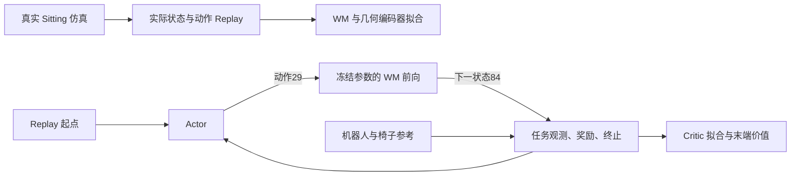

# 按任务类别组织的 SuperMimic：Sitting 模型设计

状态：用户已确认，已实现并完成回归验证。

新分支 `codex/task-specific-sitting` 从 `0873639` 创建。该提交基于已整理到
`tasks/sitting/` 的单椅实现，另有本地策略播放，不包含后来的多实体网络。
`codex/shared-entity-world-model` 保留已有实现、实验记录和检查工具。

## 目标和边界

一个任务类别拥有自己的 Actor、World Model、Critic 及输入定义。先实现 Sitting：
每个环境固定包含一个 G1 和一把动态椅子，不同环境可以采用不同椅型、尺寸和参考。
普通 Tracking 保留独立任务和模型；未来其他任务在各自任务目录定义网络。

复用的是训练算法、几何编码组件、标准数据格式和仿真基础设施，不要求不同任务
使用相同网络参数、状态布局或 checkpoint。WM 在 Sitting 的实际转移上学习机器人
与椅子的耦合动力学，为 Actor 提供可微分想象轨迹。更快收敛是后续需要验证的效果。

取消通用物体槽位、presence/dynamic/target 标记、物体 mask、关系注意力和
跨任务 Replay 混合。Sitting 不支持额外未建模的交互物体；加入这类物体需要明确
修改该任务的状态、网络和奖励。

## 共同约定

- 控制频率 50 Hz，物理频率 200 Hz；Actor 历史长度 10，未来参考长度 10。
- G1 保留 29 个关节，动作是 29 维关节目标偏移。
- `H` 是当前实际 G1 pelvis 的 yaw 旋转，位置原点为当前 pelvis。
- 椅子位置观测为 `Hᵀ(p_chair-p_robot)`，姿态为 `Rot6D(HᵀR_chair)`。
- 椅子线速度和角速度是世界绝对速度在 `H` 下表达，各 3 维；不减机器人速度。
- Replay 状态用四元数，网络姿态特征用 Rot6D，旋转增量/局部姿态误差用旋转向量。
- 几何 ID 是整数查表元数据，不作为连续网络输入，也不占下面的网络输入维度。

## 几何编码

沿用多实体分支的采样和 PointNet 语义：按碰撞表面面积确定性采样 1024 点，
每点为局部坐标 xyz 和单位法向，共 `1024×6`。保持资产原点和实际米制尺寸，
只应用一次缩放。物体位姿变化不改变局部点云；更换资产或尺寸会改变点云。

```text
1024×6 → 逐点 MLP 6→64→128 → max pooling 128
       → 拼接米制包围盒尺寸3 → Linear 131→64 → geometry64
```

Actor、WM、Critic 使用同一个编码器实例，只有 WM optimizer 更新它。
Actor/Critic 使用 detach 的几何特征，重新计算当前权重下的编码；不把 learned
embedding 写入 Replay 或动态观测历史。编码器更新后，不能复用旧权重的特征缓存。

## Actor：1116 → 29

| 输入 | 拆分 | 维度 |
|---|---|---:|
| G1 单帧本体观测 | 相对关节位置29、关节速度29、body角速度3、重力投影3、上一动作29 | 93 |
| 椅子单帧观测 | heading相对位置3、相对姿态Rot6D6 | 9 |
| 动态历史 | 10 × (93 + 9) | 1020 |
| 未来机器人参考 | 10 × 73，经目标编码器压缩 | 730 → 32 |
| 静态几何 | 当前椅子的共享 PointNet 输出，只拼一次 | 64 |
| 解码器输入 | 1020 + 32 + 64 | 1116 |

未来机器人参考每帧 73 = root位移3 + Rot6D姿态6 + body线/角速度6 + q29 + 0.1×qd29。
沿用当前 MotionLib：位移和姿态相对**当前参考机器人**的 heading，速度在对应
参考 body frame 表达；不是相对当前实际机器人的 heading。

```text
目标编码器：730 → 2048 → 1024 → 512 → 256 → 32 → tanh
动作解码器：1116 → 2048 → 1024 → 512 → 256 → 29
```

隐藏层沿用 ELU。只归一化原始动态观测和目标，不对随 WM 更新的 geometry64
维护长期运行统计。Actor 不接收特权质量/摩擦/椅子速度。

已确认的输入选择：第一版沿用机器人未来参考，不新增椅子未来参考。
这不支持仅改变物体目标、却保持相同 Actor 输入的任务区分。若希望 Actor 也看到
椅子未来参考，将目标输入改为 `730 + 90 = 820 → 32`；解码器仍是 1116 维，
但目标编码器、参考接口及 checkpoint 语义发生变化。

## World Model：224 → 82

| 输入 | 拆分 | 维度 |
|---|---|---:|
| G1 状态特征 | 高度1、去yaw姿态6、body线/角速度6、q29、qd29 | 71 |
| 椅子状态特征 | heading相对位置3、Rot6D姿态6、线/角速度6 | 15 |
| 执行动作 | 29个关节动作 | 29 |
| G1 物性 | 地面摩擦1、关节标定偏移29、torso COM偏移3 | 33 |
| 椅子物性 | 质量1、COM3、对称惯量6、G1–椅子摩擦1、椅子–地面摩擦1 | 12 |
| 几何 | geometry64 | 64 |
| 合计 | 71 + 15 + 29 + 33 + 12 + 64 | 224 |

MLP：`224 → 2048 → 2048 → 2048 → 82`，隐藏层 SiLU + LayerNorm。
原始物理输入及回归输出用运行统计归一化；geometry64 不使用运行归一化。

输出是 G1 增量70 + 椅子增量12。两者的增量都是位置3、旋转3、线速度3、角速度3，
G1 另有 q29、qd29。椅子位置/速度增量在当前 G1 heading 表达，旋转增量在椅子
body frame 表达。沿用已有 G1 增量定义。积分后重新计算下一时刻的观测与奖励。

Replay 保存 G1 状态71 + 椅子状态13 = **84**，物性 **45** 维及独立几何元数据。
G1 Replay 的 71 维和上述网络特征的 71 维语义不同：前者保留世界位置和四元数。
参考轨迹、奖励和任务 ID 不作为 WM 输入。

## Critic：1101 → 1

| 输入 | 维度 |
|---|---:|
| 原机器人当前特征 | 184 |
| 当前椅子状态 | 15 |
| 当前椅子参考误差：位置3 + 相对旋转向量3 | 6 |
| 椅子物性 | 12 |
| 几何 | 64 |
| 未来机器人参考 | 730 |
| 未来椅子参考：10 × (位置3 + Rot6D姿态6) | 90 |
| 合计 | 1101 |

机器人184 = invariant状态71 + 关节误差29 + 14个body位置误差42 + root位置误差3 + 相对参考姿态Rot6D6 + G1物性33。这里已经包含 G1 物性，不重复添加。

未来椅子参考全部使用**当前实际 G1**的同一个 heading 和 pelvis 原点，和当前
椅子状态一致。机器人参考继续保持上文的既有定义，两个参考块分别处理。
当前旋转误差的3维是局部残差，未来旋转的6维是姿态表达，不是维度遗漏。

MLP：`1101 → 256 → 128 → 1`，隐藏层 ELU。输出预计剩余折扣回报，为想象轨迹
末端提供 bootstrap。原始数值块归一化，geometry64不做长期运行统计。

## 学习路径



Actor 更新时冻结 WM 和 Critic 参数，但保留动作通过 WM 到奖励/价值的梯度。
共享几何编码器参数明确排除在 Actor/Critic optimizer 之外。
初版保留当前算法：8步 WM 拟合、32步想象、WM warmup、Critic lambda-return、
真实与想象共用奖励/终止。坐椅子奖励仍为原机器人 tracking 加椅子位姿跟踪；
质量5–15kg、G1–椅子摩擦0.3–1.2，评估10kg/1.0。

## 代码整理与工程能力

```text
motion_data/                 标准格式、数据源转换、碰撞、reference/split
supermimic/
  assets/g1/                G1资产和FK
  mdp/                      已有机器人张量计算及仿真适配
  rl/
    models.py               MLP、运行归一化等小组件
    geometry.py             点云数据和共享PointNet组件
    runner.py               WM拟合、Actor想象、Critic训练
    storage.py / vecenv.py   在线Replay和实际转移采集
    distributed.py          与任务无关的多卡同步
  tasks/
    base.py                 最小任务接口、模型构造、schema
    g1_tracking/            Tracking自己的模型和任务配置
    sitting/
      dynamics.py           固定G1+单椅状态、特征、积分
      models.py             Sitting Actor / WM / Critic
      task.py / mdp.py      观测、参考、奖励和终止
      assets.py / variants.py
      commands.py / events.py / env_cfgs.py / motion.py
      experiment.py         多椅训练和数据清单
  scripts/                  训练、部署和评估入口
tools/                      数据/资产准备、reference选择、纯运动学回放
```

任务提供模型构造和输入接口；runner 不通过 Shared/Entity/Sitting 类型分支选网络。
移除 SharedTracking 注册与跨任务共享 WM/Replay 兼容层。普通 Tracking 作为独立
基线保留，原资产、标准 NPZ 和已选 reference 清单可继续使用。

从 `21913f8` 选择性移植以下能力，而不是整套 entity 网络：

1. 双卡参数/梯度/归一化统计同步、rank0保存、rank间物理失败传播。
2. 接触容量25%余量与128/512对齐、EPA scratch、Replay拒绝overflow。
3. 每个环境一把椅子的原生资产变体；保留碰撞slot修正及每环境质量/惯性随机化。
4. 椅型隔离的80/20划分和reference白名单；多椅训练优先维护一种混合variant方式。
5. default/compact碰撞缓存、冻结策略部署、clean/perturbed/随机phase reset。

保留统一运动回放、碰撞准备/检查、reference筛选、训练数据清单生成及一个部署入口。
一次性OOM/原点诊断脚本和重复播放入口不引入新分支主工具集；证据保留在原分支。

测试保留行为边界：状态/坐标变换及积分一致性；WM到动作的梯度、编码器optimizer归属；
真实reset/接触/随机化/overflow；训练保存续训与冻结部署；双进程同步及失败传播；
数据划分防泄漏与FK/碰撞资产回归。删除重复测试或过时跨任务协议测试，不按文件数量
删除仍能捕获真实物理错误的测试。

新网络使用新的 task/checkpoint schema。已有多实体 checkpoint 不隐式切片或转换；
旧实验继续使用原分支部署。


## 实施验证（2026-10-28）

完整回归套件首次运行167项通过，随后新增的未建模物体拒绝检查通过。
测试包含真实CUDA物理/完整网络训练/保存续训/冻结推理，以及CPU两进程Gloo同步。
本机只有一张GPU，尚未在此分支上运行真实双GPU仿真训练。

另从现有reference清单建立独立诊断子集：两把真实训练椅、四个环境、一把heldout椅。
通过新train_sitting入口以默认完整网络、BF16、torch.compile训练至iteration1，
保存后从新进程续训至iteration2，再通过play_policy加载并在heldout椅执行8步。
输出记录frozen_policy=true，按显式步数上限停止。小规模检查验证工程链路，
不表示策略收敛或稳定坐下成功。

本地诊断记录在 `logs/task_sitting_smoke_20261028/`，不改变正式训练数据清单。
